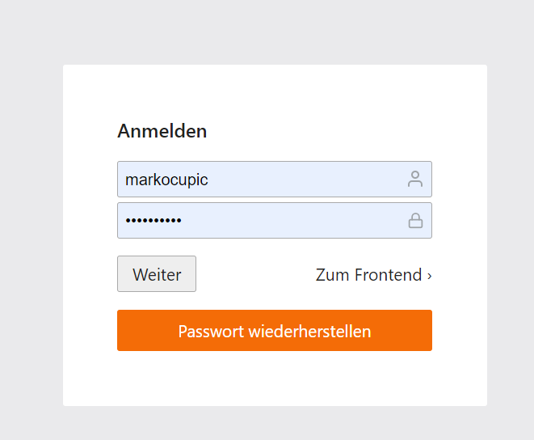
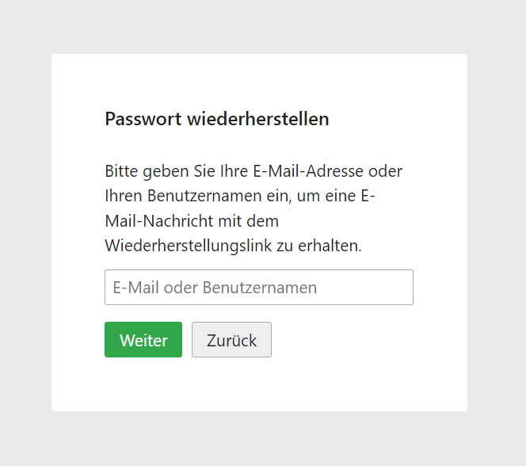
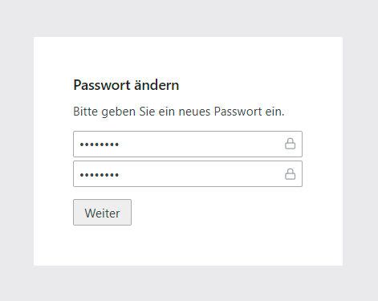

# Contao Backend Password Recovery Bundle

**Never send users passwords via email.**

This plugin displays a “recover password button” **after** incorrect entry of the **backend user password**.
By entering the user name or e-mail address, the user **is sent an e-mail with a link**.
This allows the backend user to restore their password.

## Requirements

- PHP 8.4+
- Contao 5.3 or Contao 6
- Optional: [terminal42/notification_center](https://github.com/terminal42/contao-notification_center) 2.x

## Installation

- On your console you can run `composer require markocupic/backend-password-recovery-bundle`
- Or you can install the extension via Contao Manager.
- Don't forget to update the database: run `vendor/bin/contao-console contao:migrate` or use the database migration in the Contao Manager. The bundle adds the columns `tl_user.pwResetToken` and `tl_user.pwResetLifetime`.

## The password recovery process

| If an invalid password is entered, the “Restore password” button is displayed. | Enter your user name or e-mail address. | User receives an e-mail with a link and sets up their new password. |
|--------------------------------------------------------------------------------|-----------------------------------------|---------------------------------------------------------------------|
|                                           |    |                                |

## Notification Center

The Notification Center is optional. Install it with `composer require terminal42/notification_center`, if you want to use it.

If no notification of the ‘Type Backed user: Password recovery’ has been created, Contao will automatically send an email with the recovery link using the Symfony mailer.

If you would like to send the recovery link via the Notification Center, you must first create a message of type ‘Backed user: Password recovery’ in the Contao backend.

```
Hello ##user_username##

Here is your password recovery link:

##link##

Please note that the link is only valid for ##token_lifetime## min.

Kind regards

##admin_name##
```

## Configuration

No further configuration is required after installation.
The **email subject** and **email text** can be customized via the **language file**.

```
// contao/languages/de/default.php
$GLOBALS['TL_LANG']['MSC']['pwRecoveryEmailSubject'] = 'Lorem ipsum';
$GLOBALS['TL_LANG']['MSC']['pwRecoveryEmailText']  = 'Lorem ipsum';
```

To increase **security**, the default **validity period** of the **link** is 10 minutes. However, this can be adjusted in the `config/config.yaml` file.

```
# config/config.yaml
markocupic_backend_password_recovery:
    token_lifetime: 900 # default 600 s (10 min)
```

By default, the “Restore password” button **is only displayed after an incorrect password** has been entered.
However, this can be adjusted so that the button is **permanently visible**.

```
# config/config.yaml
markocupic_backend_password_recovery:
    show_password_recovery_link_on_login_failure_only: false # Default true
```
